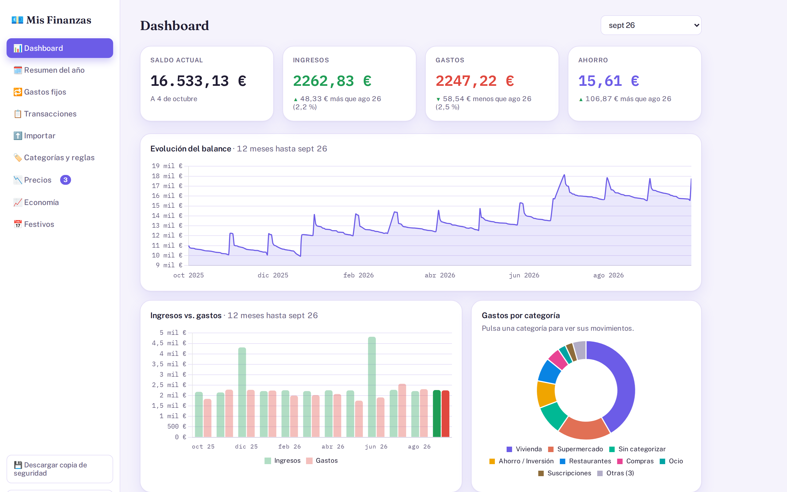
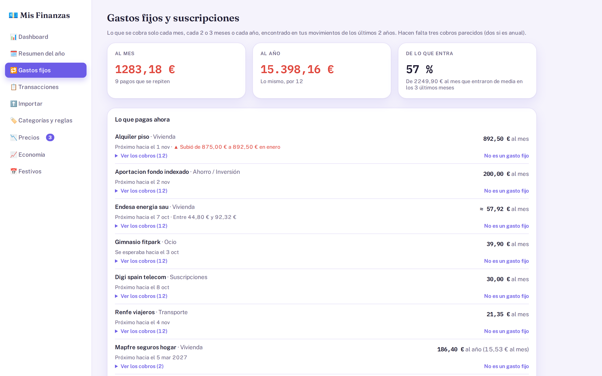
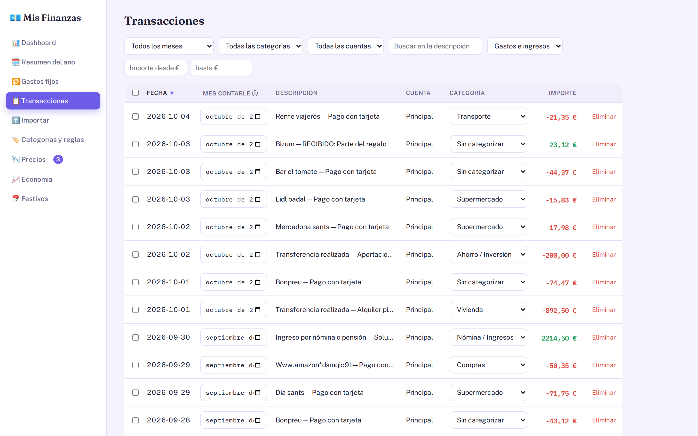
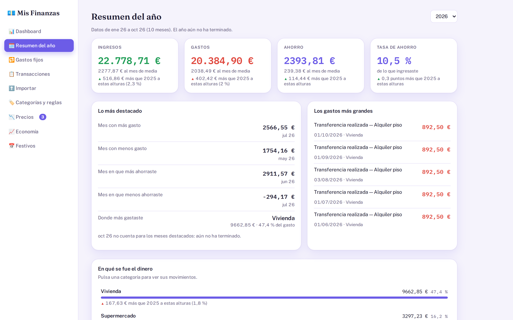
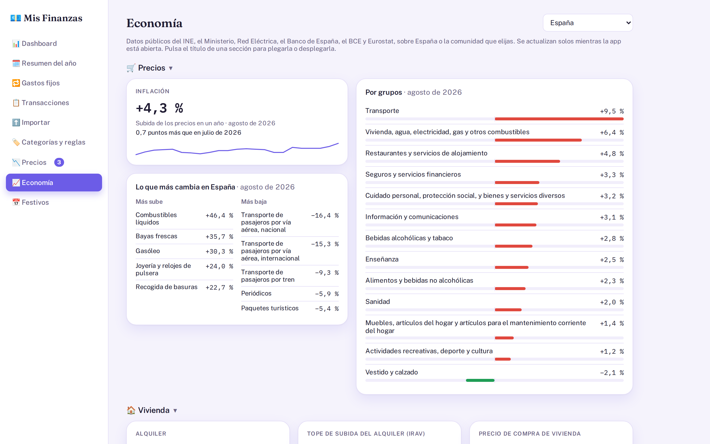
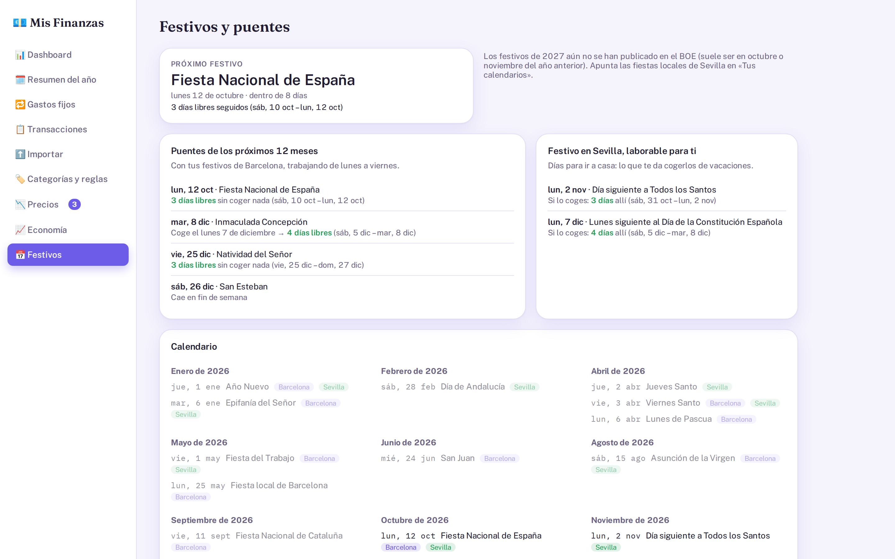
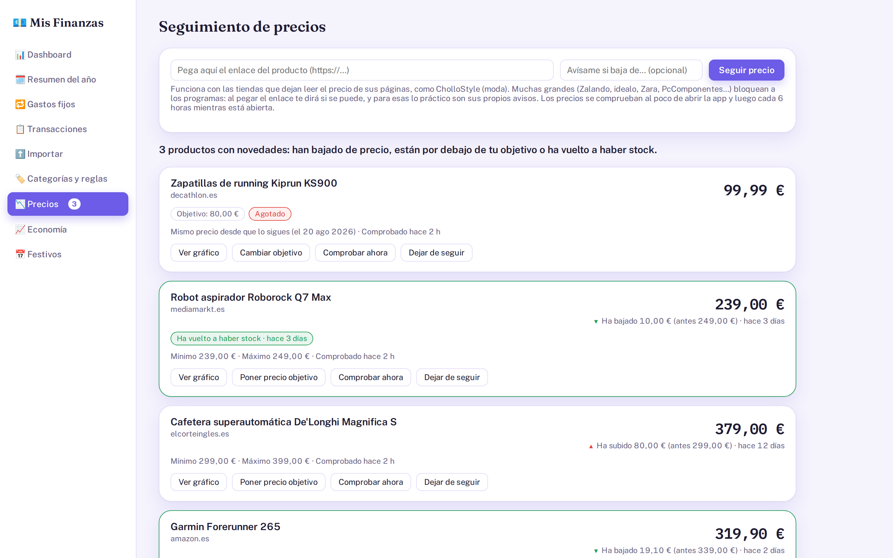
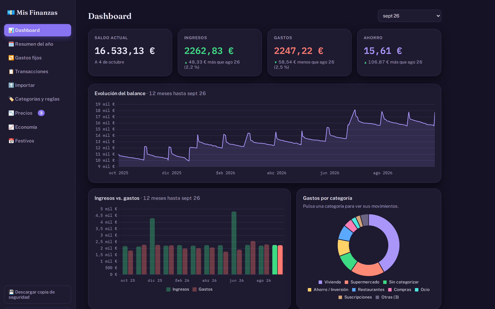
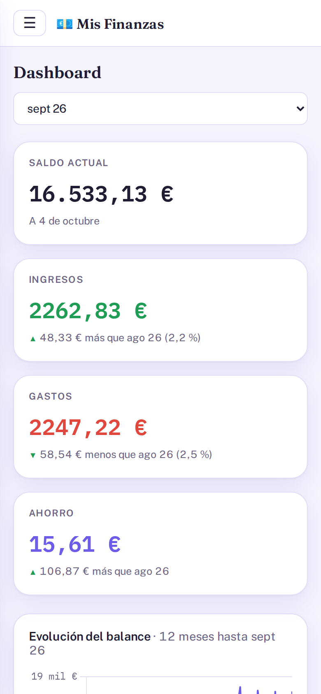
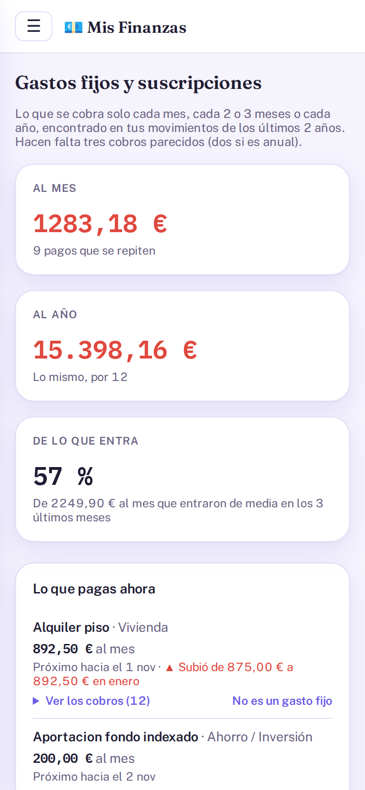

# Mis Finanzas

A local-first personal finance dashboard. It downloads bank movements (or imports Excel/CSV exports),
categorizes them with keyword rules and turns them into a dashboard, a yearly summary and a list of the fixed
expenses and subscriptions hidden in them. It also tracks product prices, shows public economy data for Spain
and plans long weekends from the official holiday calendar.

It runs on your own computer, stores everything in one SQLite file and is reached from the phone over the
home Wi-Fi. No cloud, no account, no tracking. The interface is in Spanish.



## Try it in one minute

You only need a **JDK 21**. The demo fills the app with two years of invented movements, products and a
saved copy of the public data, so it works offline and never touches real data:

```bash
./demo.sh
```

Then open <https://127.0.0.1:8001> and log in as `demo` / `demo`. The certificate is self-signed, so the
browser warns once.

## What it does

| | |
|---|---|
| **Dashboard and yearly summary** | Balance over time, income vs. expenses, spending by category, comparisons with the previous period and monthly averages. |
| **Transactions** | Filter, sort, recategorize in bulk. After a manual correction the app suggests a rule and shows how many movements it would change before creating it. |
| **Import** | Excel/CSV from any bank: it finds the header row and guesses the columns (dates, amounts in Spanish or English format, debit/credit), and never stores the same movement twice. |
| **Bank download** | BBVA through [Enable Banking](https://enablebanking.com) (PSD2 open banking): link the account once, then "update" downloads what's new. Warns a month before the consent expires. |
| **Fixed expenses** | Finds what gets charged by itself every month, quarter or year (rent, electricity, subscriptions), its price changes and the ones that stopped. Nothing to type in. |
| **Prices** | Paste a product link; it reads the price from the page's structured data every few hours and flags drops, targets reached and products back in stock. |
| **Economy** | Inflation by group and region, rent, house prices, mortgages, Euríbor, ECB rates, fuel and electricity prices, unemployment and Spain vs. the EU, from INE, the Bank of Spain, the ECB, Eurostat, Red Eléctrica and the Ministry. |
| **Holidays** | National and regional holidays read from the BOE, local ones for Catalan towns, and the long weekends you can make by taking one or two days off. |

| | | |
|---|---|---|
|  |  |  |
|  |  |  |
|  |  |  |

## Stack

- **Backend**: Java 21, Spring Boot 4 (Spring Framework 7), Spring Data JPA / Hibernate 7, Spring Security,
  SQLite. Apache POI and Commons CSV for imports, jsoup for HTML, Nimbus JOSE+JWT for the bank API.
- **Frontend**: plain HTML, CSS and JavaScript, no framework and no build step. Chart.js for the charts.
  Every library and font is vendored, so the app works without internet.
- **Tests**: JUnit 5, AssertJ, MockMvc and `MockRestServiceServer` (about 400 Java tests, with JaCoCo
  coverage); `node:test` + jsdom for the frontend (about 340 tests that load the real `index.html` against
  an in-memory fake of the API).

## Design notes

Some of the decisions behind it, each explained in more detail in `docs/`:

- **Duplicates are recognised across sources and over time.** Each movement gets a SHA-256 key from
  account, date, description and amount. When the description format changed (a different detail column
  chosen in an import, the bank's raw text vs. a cleaned one), the old keys were kept valid by also checking
  each row against its alternative descriptions instead of migrating stored data. A test pins hashes
  computed by older code so a refactor can't silently re-import everything.
- **Balances are rebuilt backwards.** The bank API gives only the current balance, so the running balance of
  each movement is computed from today back. Checked against the bank's own export, it matched to the cent.
- **Imports are atomic.** All rows of an import are saved in one transaction: a failure leaves nothing
  half-imported, and 3,000 rows went from ~18 s to under 2 s.
- **Money is `BigDecimal`** everywhere in Java, rounded to cents by a JPA converter.
- **Fixed expenses are detected, not entered**: movements are grouped by payee (or by category and amount
  when the description names nobody, like a cash withdrawal), then a group counts when the gaps between
  charges fit a monthly, bimonthly, quarterly or yearly cadence. Variable bills like electricity have
  stricter rules so that weekly shopping or a yearly holiday never qualifies.
- **Security for a home network**: HTTPS with a certificate generated on first run, HTTP Basic with a
  lockout after repeated failures, a strict Content-Security-Policy (no inline scripts at all), and outgoing
  requests for product links refused for private and local addresses.
- **Public sources have their quirks**: INE series are picked by name because their codes change when the
  INE rebases; the Ministry's fuel server only speaks a TLS cipher Java 21 disables, so that one source goes
  through `curl` instead of weakening TLS for the whole JVM; holidays come from the BOE because free holiday
  APIs miss the Sunday holidays a region moves to Monday.

## Running it with your own data

```bash
./iniciar.sh
```

builds the jar when the code changed and starts the app at <https://127.0.0.1:8000> (and on your local IP,
for the phone). The first run prints a generated admin password once. Everything lives in `data/`: the
database `data/finanzas.db`, a backup taken automatically before each start, and the HTTPS certificate.
`./copia-usb.sh` makes an encrypted copy of it on a USB drive.

From there, import your bank's Excel or CSV export in **Importar**. To download from the bank instead, you
need a free Enable Banking application of your own; the steps are in
[docs/bank-sync.md](docs/bank-sync.md#bank-sync-setup).

## Tests

```bash
./mvnw test                                        # Java
cd src/test/frontend && npm install && npm test    # frontend, needs Node 22+
```

Tests never touch `data/` and never reach the internet: the bank, shops and public sources are mocked.

## Project layout

```
src/main/java/com/misfinanzas/
  entity/, repository/   JPA entities and repositories
  service/               import, bank client, categorization, summaries, fixed expenses
  service/prices/        price tracking
  service/economy/       public economy data
  service/holidays/      holidays and long weekends
  security/              authentication, lockout, Content-Security-Policy
  startup/               backups, HTTPS certificate, seed data, demo mode
  web/                   REST controllers
src/main/resources/static/   the frontend: index.html, one script per view
docs/                        how each part works
```

The `docs/` folder has one file per part: [server](docs/server.md), [import](docs/import.md),
[bank sync](docs/bank-sync.md), [frontend](docs/frontend.md), [fixed expenses](docs/recurring.md),
[prices](docs/prices.md), [economy](docs/economy.md), [holidays](docs/holidays.md), [demo](docs/demo.md)
and [testing](docs/testing.md).

## License

[MIT](LICENSE)
